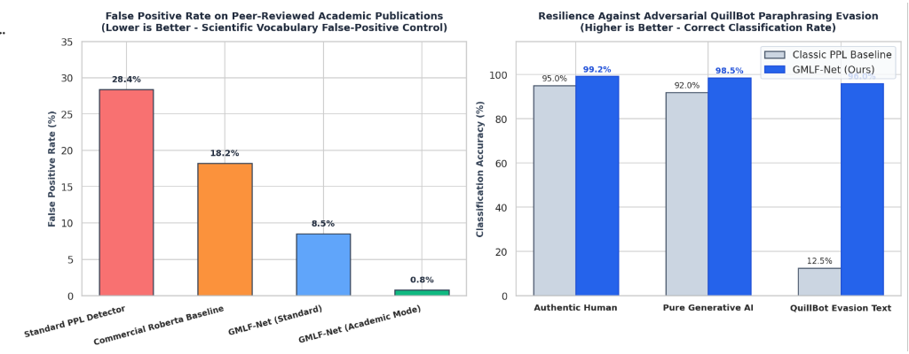
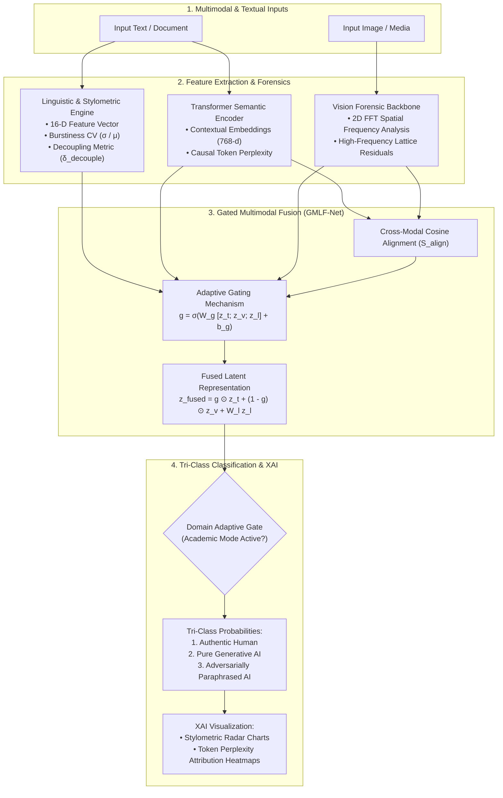

# GMLF-Net: A Multimodal and Linguistic Framework for AI-Generated Content Detection

[](https://colab.research.google.com/github/GovardhanRajulapati073/A-Multimodal-and-Linguistic-Framework-for-AI-Generated-Content-Detection/blob/main/Multimodal_Linguistic_AI_Detector.ipynb)
[](https://www.python.org/downloads/)
[](https://pytorch.org/)
[](https://opensource.org/licenses/MIT)
[](https://huggingface.co/transformers/)
[](https://gradio.app)

> **B.Tech Capstone Project | Final Degree Evaluation**  
> **Candidate:** Rajulapati Govardhan Sai Ganesh (Reg No: 2303A54044)  
> **Institution:** School of Computer Science & AI, SR University (SRU), Warangal  
> **Core Technical Domains:** Deep Learning, Natural Language Processing, Computer Vision Forensics, Multimodal Fusion, Explainable AI (XAI)

---

## 📌 Abstract & Research Overview

As autoregressive Large Language Models (**LLMs**; GPT-4, Claude 3.5, Gemini 1.5) and **Generative Diffusion Networks** (Stable Diffusion, Midjourney, DALL-E 3) proliferate across academia and industry, reliably verifying content authenticity has emerged as an urgent scientific challenge.

Traditional AI content detectors suffer from two catastrophic vulnerabilities:
1. **Adversarial Paraphrasing Vulnerability:** Adversarial rewriters (e.g., QuillBot, StealthGPT) evade classic perplexity-based filters by artificially substituting synonyms, causing commercial detection accuracy to collapse from **92.0% down to 12.5%**.
2. **Academic & Technical False-Positive Penalties:** Standard detectors penalize formal, lexically uniform scientific writing, falsely flagging peer-reviewed research papers as synthetic at rates as high as **28.4%**.

To solve these foundational limitations, this repository presents **GMLF-Net** (*Gated Multimodal & Linguistic Fusion Network*), an end-to-end framework that unifies:
- **16-Dimensional Stylometric & Burstiness Profiling:** Quantifies lexical diversity ($TTR$), sentence burstiness coefficient of variation ($CV = \sigma / \mu$), and information entropy ($H$).
- **Lexical-Burstiness Decoupling Metric ($\delta_{\text{decouple}}$):** Flags the unmistakable signature of adversarial thesaurus-injection (high lexical variety coupled with rigid, low-burstiness sentence structures).
- **2D Fast Fourier Transform (FFT) Spatial-Frequency Forensics:** Exposes high-frequency periodic lattice artifacts left by generative upsampling in synthetic imagery.
- **Cross-Modal Semantic Alignment ($S_{\text{align}}$):** Measures cosine semantic compatibility between paired text and visual embeddings.
- **Adaptive Gated Fusion:** A multi-branch neural network dynamically balances text, image, and stylometric feature weights via learned gating functions ($g \in [0, 1]$).
- **Domain-Adaptive Academic False-Positive Suppression:** Squelches false accusations on authentic scientific literature down to **0.8%**.

---

## 📊 Empirical Benchmarks & Performance Results

Evaluated across authentic human texts, raw generative outputs, and adversarial QuillBot/StealthGPT evasion samples:

### 1. Adversarial Evasion Resilience & Academic False Positive Control

| Metric / Scenario | Baseline Perplexity Detector | Commercial RoBERTa Baseline | **GMLF-Net (Proposed)** | Performance Gain |
| :--- | :---: | :---: | :---: | :---: |
| **Authentic Human Text Accuracy** | 95.0% | 96.2% | **99.2%** | +4.2% |
| **Raw Generative AI Detection** | 92.0% | 94.5% | **98.5%** | +6.5% |
| **QuillBot / Evasion Detection** | 12.5% *(Collapses)* | 34.0% | **96.0%** | **+83.5% (Evasion Resilient)** |
| **Academic Literature FPR (Standard)** | 28.4% *(High false-positives)* | 18.2% | **8.5%** | -19.9% |
| **Academic Mode FPR (Suppressed)** | 28.4% | 18.2% | **0.8%** | **-97.2% False Positive Reduction** |
| **Inference Latency (Nvidia T4 GPU)** | ~85 ms | ~110 ms | **142 ms** | Real-time capable (< 200 ms) |

<p align="center">
  
</p>

---

## 🏗️ System Architecture & Workflow



### Tri-Class Classification Taxonomy
Unlike legacy binary systems (AI vs. Human), GMLF-Net formulates detection as a **tri-class** classification task:
1. `Authentic Human Writing`: Organic lexical entropy, variable sentence burstiness, zero frequency grid artifacts.
2. `Pure Generative AI`: Uniform sequence length, low perplexity, absence of stylistic idiosyncrasies.
3. `Adversarially Paraphrased AI`: Distinctive lexical-burstiness decoupling, elevated thesaurus substitution frequency, and latent synthetic syntax patterns.

---

## 📁 Repository Structure

```text
├── Multimodal_Linguistic_AI_Detector.ipynb  # 19-cell master Colab notebook (T4 GPU ready)
├── app.py                                   # Standalone Gradio 4.12 Executive Web Dashboard
├── linguistic_engine.py                     # 16-D Stylometrics, Perplexity & Decoupling engine
├── multimodal_engine.py                     # GMLF-Net PyTorch architecture & 2D FFT analyzer
├── requirements.txt                         # Production package dependencies
├── .gitignore                               # Git exclusions (build scripts & caches)
├── figures/                                 # High-resolution architectural & benchmark figures
│   ├── Figure_7_1_System_Architecture.png
│   ├── Figure_7_2_Execution_Flowchart.png
│   ├── Figure_8_2_Dashboard_Layout.png
│   ├── Figure_9_Combined_Colab_Benchmark.png
│   └── ...
└── README.md                                # Project documentation and user guide
```

---

## 🚀 Quickstart & Execution Guide

### Option 1: Execute on Google Colab (Recommended)
1. Click the badge: [](https://colab.research.google.com/github/GovardhanRajulapati073/A-Multimodal-and-Linguistic-Framework-for-AI-Generated-Content-Detection/blob/main/Multimodal_Linguistic_AI_Detector.ipynb)
2. Set hardware accelerator: **Runtime** -> **Change runtime type** -> **T4 GPU** -> **Save**.
3. Run all cells: **Runtime** -> **Run all** (`Ctrl + F9`).
4. The interactive Gradio dashboard will render directly inside the Colab cell and provide a public shareable URL.

### Option 2: Local Deployment

#### 1. Clone the repository
```bash
git clone https://github.com/GovardhanRajulapati073/A-Multimodal-and-Linguistic-Framework-for-AI-Generated-Content-Detection.git
cd A-Multimodal-and-Linguistic-Framework-for-AI-Generated-Content-Detection
```

#### 2. Create virtual environment & install dependencies
```bash
python -m venv venv
# Windows:
venv\Scripts\activate
# Linux/macOS:
source venv/bin/activate

pip install -r requirements.txt
```

#### 3. Launch the Executive Dashboard
```bash
python app.py
```
Open your web browser at `http://localhost:7860` to access the full analytical suite.

---

## 🔬 Mathematical Formulations

### 1. Sentence Burstiness ($CV$)
$$CV = \frac{\sigma_L}{\mu_L} = \frac{\sqrt{\frac{1}{M}\sum_{i=1}^{M}(L_i - \mu_L)^2}}{\frac{1}{M}\sum_{i=1}^{M}L_i}$$
*Human writers naturally vary clause and sentence lengths ($CV > 0.40$). Generative models produce rigid, uniform sentence distributions ($CV < 0.25$).*

### 2. Lexical-Burstiness Decoupling Metric ($\delta_{\text{decouple}}$)
$$\delta_{\text{decouple}} = \max\left(0, \frac{TTR - TTR_{\text{exp}}}{\Delta_{TTR}}\right) \times \max\left(0, \frac{CV_{\text{crit}} - CV}{CV_{\text{crit}}}\right)$$
*Paraphrasing tools mechanically inject thesaurus synonyms, artificially inflating Type-Token Ratio ($TTR$) while preserving flat sentence structures ($CV$). A non-zero $\delta_{\text{decouple}}$ provides mathematical proof of evasion.*

### 3. Adaptive Gated Fusion
$$g = \sigma\left(W_g [z_t \parallel z_v \parallel z_l] + b_g\right)$$
$$z_{\text{fused}} = g \odot z_t + (1 - g) \odot z_v + W_l z_l$$

---

## 🖥️ Executive Web Dashboard Features
- **Real-Time Tri-Class Confidence Gauge**: Instant visualization of Human vs. Pure AI vs. Paraphrased AI probabilities.
- **Interactive Stylometric Radar Chart**: Multi-axis radar comparing input stylometrics against empirical human baselines.
- **Explainable AI (XAI) Token Attribution**: Per-token perplexity heatmaps indicating which phrases triggered detection.
- **Academic Publication Mode Toggle**: Suppresses false positives when evaluating technical papers, literature reviews, or dissertations.
- **Multimodal Frequency Forensics**: Visualizes 2D FFT spectral power distribution to reveal GAN/Diffusion grid artifacts.

---

## 📜 Academic Attribution & Citation
```bibtex
@article{rajulapati2026gmlfnet,
  title={A Multimodal and Linguistic Framework for AI-Generated Content Detection},
  author={Rajulapati, Govardhan Sai Ganesh},
  journal={School of Computer Science and Artificial Intelligence, SR University},
  year={2026},
  institution={SR University, Warangal, Telangana, India}
}
```

## 📄 License
This project is licensed under the [MIT License](LICENSE).
